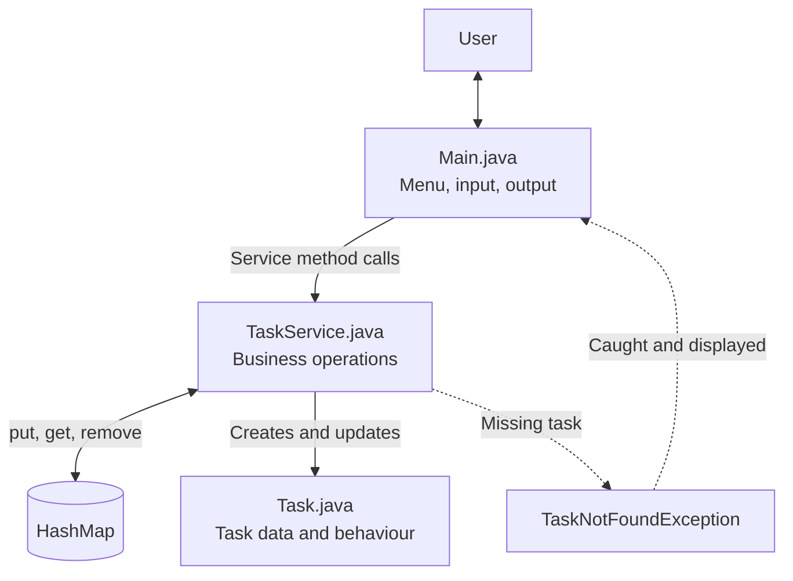
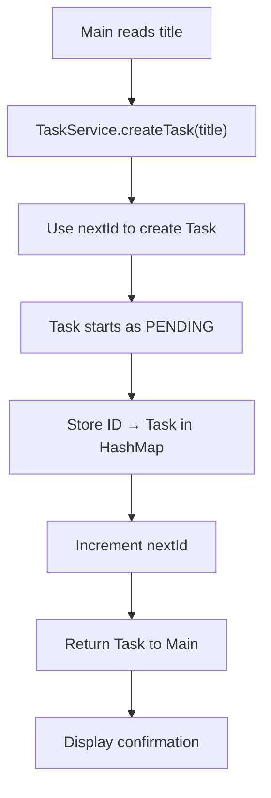
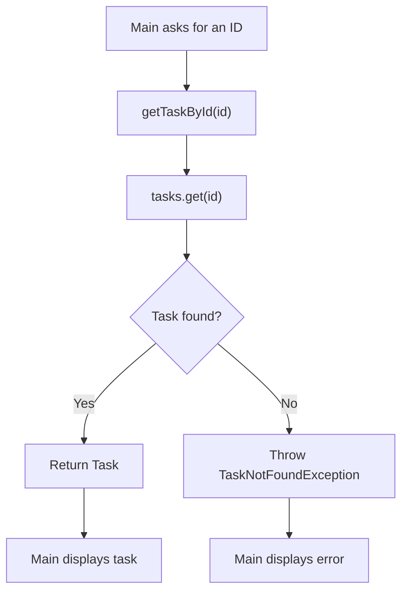
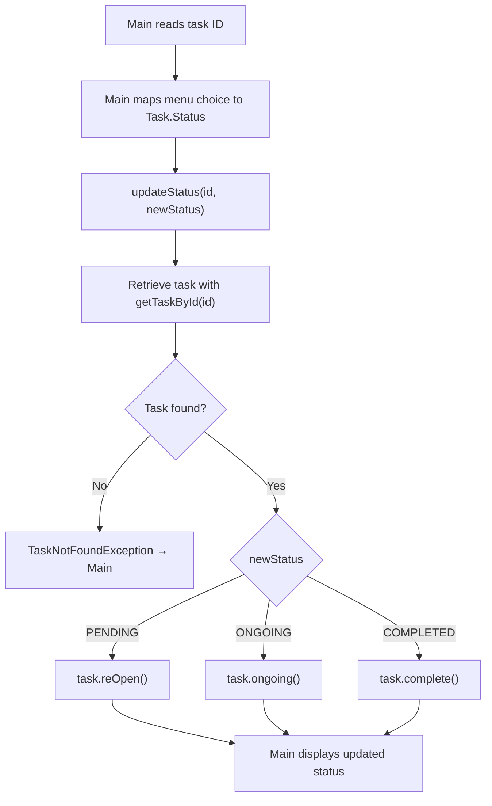
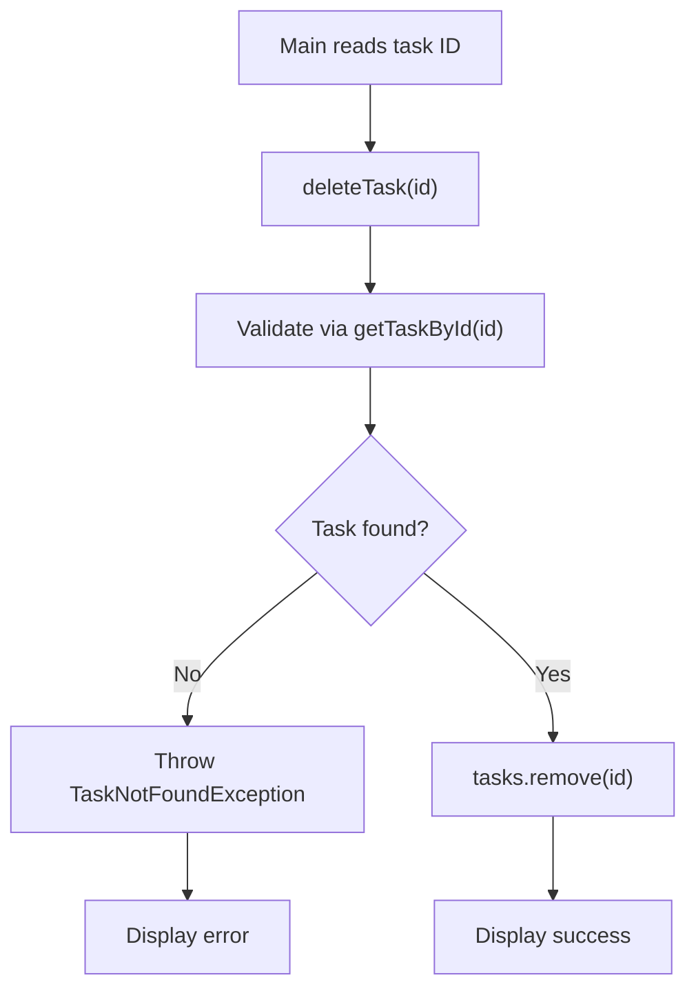

# Mini Task Manager — Plain Java

A console-based task manager built with **Core Java** to practise object-oriented design, collections, enums, exception handling, and multi-class program flow. The application uses an in-memory `HashMap`; it does not use Spring Boot or a database.

## Features

- Create tasks with automatically generated integer IDs.
- List all tasks with their ID, title, and status.
- Find one task by ID.
- Update a task's status to `PENDING`, `ONGOING`, or `COMPLETED`.
- Delete a task by ID.
- Handle missing task IDs with a custom `TaskNotFoundException`.
- Keep the menu running until the user chooses `0` to exit.

## Requirements

- A Java JDK installed and available on `PATH`.
- A terminal opened in the directory containing the `.java` files.

## Compile and run

Compile all source files:

```powershell
javac *.java
```

Run the application:

```powershell
java Main
```

## Console menu

```text
===== TASK MANAGER =====
1. Create task
2. List all tasks
3. Find task by ID
4. Update task status
5. Delete task
0. Exit
```

When updating a task, the application displays a status submenu:

```text
1. PENDING
2. ONGOING
3. COMPLETED
```

Tasks are held in memory. They are available throughout the current run, but **they are lost when the application exits**.

## Project structure

Keep these files in the same directory. The current version uses Java's default package.

```text
Todo_list/
├── Main.java
├── Task.java
├── TaskService.java
├── TaskNotFoundException.java
└── README.md
```

### `Main.java` — console interface

Responsibilities:

- Create one `TaskService` instance and one `Scanner`.
- Display the menu in a `do-while` loop.
- Read the user's choices and route them through a `switch` statement.
- Read task titles and IDs from the console.
- Display task data, confirmations, and errors.
- Catch `TaskNotFoundException` for menu operations that can fail because an ID does not exist.
- Exit the loop when the user enters `0`.

`Main` handles input and output; it does not directly manage the `HashMap`.

### `TaskService.java` — service/business layer

Responsibilities:

- Own the shared task map and the ID counter.
- Create, retrieve, list, update, and delete tasks.
- Throw `TaskNotFoundException` when an operation requires a missing task.

Core fields:

```java
private final HashMap<Integer, Task> tasks;
private int nextId = 1;
```

Core methods:

| Method | Purpose |
|---|---|
| `createTask(String title)` | Creates a task, assigns an ID, stores it, and returns it. |
| `getTaskById(int ID)` | Returns the task or throws `TaskNotFoundException`. |
| `getAllTasks()` | Returns a new `ArrayList` containing the current task references. |
| `updateStatus(int ID, Task.Status newStatus)` | Finds the task and invokes the matching status method. |
| `deleteTask(int ID)` | Checks that the task exists, then removes it from the map. |

`updateStatus` reuses `getTaskById` instead of duplicating the missing-task check. `deleteTask` follows the same pattern.

### `Task.java` — domain model

Represents one task. Its fields are private:

- `ID`: immutable integer identifier.
- `title`: immutable task title.
- `status`: mutable task status.

The nested enum defines the permitted statuses:

```java
public enum Status {
    PENDING,
    ONGOING,
    COMPLETED
}
```

Every newly created task starts in `PENDING`. Status changes are exposed through specific methods rather than a general public `setStatus()` method:

| Method | Resulting status |
|---|---|
| `reOpen()` | `PENDING` |
| `ongoing()` | `ONGOING` |
| `complete()` | `COMPLETED` |

The class provides getters for the ID, title, and status.

### `TaskNotFoundException.java` — explicit missing-task error

A custom unchecked exception that extends `RuntimeException`. Its constructor passes a descriptive message to the parent with `super(message)`. The service throws it; the console layer catches it and prints `e.getMessage()`.

## Architecture

The main separation is:

- **Main:** what the user wants to do and what the user sees.
- **TaskService:** how an operation is carried out.
- **Task:** one task's data and status-changing behaviour.
- **TaskNotFoundException:** communicates a missing-task failure.



## Operation flows

### Create task



The service creates its map once in its constructor. Each task creation reuses that map; the map is not recreated for every task.

### Find a task



`HashMap.get(id)` returns `null` when the key is absent. `getTaskById` checks for `null` and throws the custom exception explicitly; it does not intentionally trigger a `NullPointerException`.

### Update status



The menu uses numeric choices, while the service accepts the enum type. This avoids passing arbitrary status strings through the service API.

### Delete a task



After deletion, the next call to `getAllTasks()` returns a fresh list that no longer includes the deleted map entry.

## Design decisions we made

| Decision | Reason |
|---|---|
| Use plain Java, not Spring Boot | Practise Core Java and program design before adding a framework. |
| Use three main classes (`Main`, `TaskService`, `Task`) | Separate console interaction, business operations, and task representation. |
| Generate IDs inside `TaskService` | Users should not choose IDs; the service owns task creation and its counter. |
| Start `nextId` at `1` and increment after using it | The first created task receives ID `1`, then IDs advance for subsequent tasks. |
| Keep one `HashMap<Integer, Task>` per service instance | Store tasks by ID and reuse the same map across menu operations. |
| Store the ID both in `Task` and as the map key | The map key supports lookup; the object can also report its own ID. Both are assigned from the same generated value. |
| Use `int` IDs and `Integer` map keys | The application generates integer IDs; Java generics use the wrapper type `Integer`. |
| Use an enum for status | Restricts status values to `PENDING`, `ONGOING`, and `COMPLETED`, catching misspelled enum constants at compile time. |
| Initialise each task as `PENDING` in its constructor | New tasks begin in a consistent valid state. |
| Use specific status methods, not a public status setter | `Task` controls its state transitions through `reOpen()`, `ongoing()`, and `complete()`. |
| Let `TaskService` throw `TaskNotFoundException` | The service knows whether the requested task exists. |
| Let `Main` catch and display the exception | Presentation stays in the console layer; the service does not print user-facing messages. |
| Reuse `getTaskById` in update and delete operations | Centralises task lookup and missing-ID handling instead of duplicating it. |
| Return a `List<Task>` from `getAllTasks()` | The console can iterate over the collection without exposing the map itself. |
| Return `new ArrayList<>(tasks.values())` | Gives the caller a separate list of the current task references. List membership does not auto-update after a later map deletion, so retrieve the list again after changes. |
| Keep `Scanner` in `Main` | Only the console layer needs direct user input. |
| Use a `do-while` loop | Show the menu at least once and repeat until the user chooses `0`. |
| Use numeric choices for the menu and status submenu | Simple console input maps cleanly to a `switch`; status choices are converted to `Task.Status` before calling the service. |

## Current limitations and next improvements

These are known limitations of this learning version, not features already implemented:

- **In-memory storage:** tasks disappear when the program exits. A later version could persist them in a file or database.
- **Input validation:** blank titles are not yet rejected.
- **Non-numeric input:** `Scanner.nextInt()` can throw `InputMismatchException` if the user types text where a number is expected. The current menu handles invalid numeric choices, but not every invalid input type.
- **Ordering:** `HashMap` does not guarantee iteration order, so listed tasks are not guaranteed to appear sorted by ID.
- **Basic ID generation:** the counter is for this running service instance and is not persisted between executions.
- **Automated tests:** the current verification has been performed by compiling and exercising the console application manually. Unit tests would make future changes safer.
- **Validation of status transitions:** the current methods assign the requested status; they do not reject repeating a transition such as completing an already completed task.

## Suggested manual test plan

1. Start the program and list tasks; the application should report that no tasks are found.
2. Create two tasks; they should receive distinct IDs and start as `PENDING`.
3. List tasks and verify ID, title, and status are displayed.
4. Find an existing task and then try a nonexistent ID; the error should be readable and the menu should continue.
5. Update a task through `PENDING`, `ONGOING`, and `COMPLETED`; verify its status after each update.
6. Delete an existing task and list the tasks again to verify it is gone.
7. Try deleting the same ID again; the application should report that the task was not found.
8. Choose `0`; the application should exit cleanly.

## Learning goals covered

This project practises classes and objects, constructors, encapsulation, enums, methods, references, `HashMap`, `List`/`ArrayList`, enhanced `for` loops, `switch`, `do-while`, `Scanner`, custom unchecked exceptions, `throw`, `try-catch`, and separating user interface code from business logic.
